# Rigorous Comparison Report: Code Reviewer & Security Reviewer Configurations

# kimi-settings vs. ZooCode

Date: 2026-10-07
Author: Research Subagent (Deep Investigator)
Status: Completed

---

## 1. Executive Summary

This report delivers a rigorous, dimension-by-dimension comparative analysis between the `code reviewer` and `security reviewer` configurations found in **`D:\OneDrive\Projects\kimi-settings`** (recently enhanced with an enterprise-grade multi-model review swarm and structured taxonomy) and **`D:\OneDrive\Projects\ZooCode`** (the active VS Code extension codebase).

### Key Finding:

- **`kimi-settings`** represents a highly evolved, multi-model orchestrator framework (VP of Engineering paradigm) with formal 8-category taxonomies, strict P0~P3 / Critical~Low severity ratings, confidence thresholds, attack-chain modeling, zero-tolerance gates, and automated 3-model cross-check consensus loops.
- **`ZooCode`** currently has **zero native configuration** for `code-reviewer` or `security-reviewer` in its primary workspace mode definition (`.roomodes`) or built-in default modes (`DEFAULT_MODES`). The only reviewer trace inside ZooCode's repository is a legacy, 5-line marketplace mode (`security-review` by `@rUv-dev`) which dangerously possesses file-editing permissions (`groups: [read, edit]`) and lacks any formal security taxonomy or gating criteria.
- While recent PR maintenance sessions in ZooCode (`docs/261003_*`) were audited by 3-model code reviews and 2-model security reviews, those audits were executed strictly through **external agent runners** (Antigravity/Kimi CLI orchestrator) using external configs, leaving ZooCode's own repository configuration completely un-updated.

---

## 2. Configuration & Prompt Artifact Inventory

| Category                               | `kimi-settings` Path                                 | `ZooCode` Path                                             | Status & Discrepancy                                                                                                                                                                                    |
| -------------------------------------- | ---------------------------------------------------- | ---------------------------------------------------------- | ------------------------------------------------------------------------------------------------------------------------------------------------------------------------------------------------------- |
| **Code Reviewer Agent**                | `agents/code-reviewer.md`                            | _(None in `.roomodes`)_                                    | 🔴 **Missing in ZooCode**. ZooCode removed legacy `pr-reviewer` and has only `pr-fixer` (a code modification mode).                                                                                     |
| **Security Reviewer Agent**            | `agents/security-reviewer.md`                        | `src/assets/marketplace/modes.yml` (`id: security-review`) | 🔴 **Outdated / Unsafe**. ZooCode has only an old community marketplace entry with write privileges.                                                                                                    |
| **Code Review Taxonomy Skill**         | `skills/code-review-taxonomy/SKILL.md`               | _(None in `.roo/skills/`)_                                 | 🔴 **Missing in ZooCode**. `.roo/skills/` only contains `evals-context`, `roo-conflict-resolution`, `roo-translation`.                                                                                  |
| **Security Review Orchestrator Skill** | `skills/security-review-orchestrator/SKILL.md`       | _(None in `.roo/skills/`)_                                 | 🔴 **Missing in ZooCode**. No security orchestration skill in ZooCode.                                                                                                                                  |
| **Deterministic Quality Gate Skill**   | `skills/quality-gate/SKILL.md`                       | _(None in `.roo/skills/`)_                                 | 🔴 **Missing in ZooCode**. ZooCode has no Stage 0 automated quality gate skill.                                                                                                                         |
| **Reviewer Swarm / Cross-Check Rules** | `SYSTEM.md` (§3a, §3b, §4), `AGENTS.md` (§2, §4, §7) | _(None in `.roomodes` or `.roo/rules-_`)\*                 | 🔴 **Missing in ZooCode**. ZooCode has no multi-model consensus or reconciliation engine in its modes.                                                                                                  |
| **Workspace Mode Integration**         | N/A (Kimi Code agent architecture)                   | `.roomodes` (ZooCode mode configuration)                   | 🔴 **Unmapped**. ZooCode's `.roomodes` defines 7 modes (`translate`, `issue-fixer`, `pr-fixer`, `merge-resolver`, `docs-extractor`, `issue-investigator`, `issue-writer`), none of which are reviewers. |

---

## 3. Deep Comparative Analysis by Dimension

### 3.1 System Prompts, Personas, and Charter

#### A. Code Reviewer

- **`kimi-settings`**:
    - **Persona**: Read-only pre-merge diff reviewer standing in for external AI reviewers (CodeRabbit-class) to ensure double-blind verification.
    - **Charter**: Pure findings and verdict; **strictly forbidden from modifying files**, running auto-formatters with write flags, or committing changes.
    - **Pipeline Awareness**: Operates as a 4-stage pipeline (Stage 0 Deterministic Scan via `quality-gate`, Stage 1 Semantic Taxonomy via `code-review-taxonomy`, Stage 2 Confidence Filter, Stage 3 Zero-Tolerance Verdict).
    - **Scope Guard**: Aborts if diff exceeds 50 files or 2,000 changed lines, enforcing decomposition before review.
    - **Intent Conformance**: Compares diff against explicit intent criteria; missing or partial logic is rated as a P1 correctness defect.
- **`ZooCode`**:
    - **Persona**: **Non-existent**.
    - **Nearest Mode**: `pr-fixer` in `.roomodes`. However, `pr-fixer` is an _active editor/developer_ ("You are Zoo, a pull request resolution specialist. Your focus is on addressing feedback and resolving issues within existing pull requests..."). It is designed to change code, not conduct independent double-blind audits.

#### B. Security Reviewer

- **`kimi-settings`**:
    - **Persona**: Framework-anchored read-only security auditor (`OWASP Top 10 2021`, `CWE Top 25`, GCP `roles/iam.securityReviewer` least-privilege).
    - **Charter**: Produces security audit deliverables; **never edits, creates, or executes code, configs, or commands**.
    - **Threat Model Brief**: Mandatory upfront threat modeling (assets, trust boundaries, entry points, attacker tiers: anonymous external, authenticated, insider, supply chain).
- **`ZooCode`**:
    - **Persona**: Naive marketplace mode (`security-review` by `@rUv-dev`).
    - **Charter**: "You perform static and dynamic audits to ensure secure code practices. You flag secrets, poor modular boundaries, and oversized files." Lacks any framework anchoring (no OWASP, no CWE, no threat model).

---

### 3.2 Review Taxonomy, Evaluation Categories, and Depth

#### A. Code Reviewer

- **`kimi-settings` (8-Category Taxonomy)**:
    1. `correctness`: Logic errors, off-by-one, inverted conditions, broken invariants, API contract misuse, missing intent requirements.
    2. `security`: Injection, authn/authz gaps, secret exposures, SSRF, path traversal (bypasses confidence filter directly to handoff).
    3. `stability`: Crash paths, unhandled errors/panics, race conditions, deadlocks, missing awaits, unhandled promise rejections.
    4. `data-integrity`: Validation gaps, transaction boundaries, migration safety, idempotency, partial failures, backward compatibility.
    5. `performance`: Superlinear complexity, N+1 queries, unnecessary allocations, blocking I/O on hot paths, unbounded growth.
    6. `maintainability`: Dead code, duplication, oversized functions, leaky abstractions, misleading naming.
    7. `test-coverage`: Uncovered changed logic, missing edge cases (null, empty, boundary, concurrency), tautological assertions.
    8. `style-docs`: Naming convention drift, documentation/code mismatch.
    - _Anti-Pattern Defenses_: Explicitly lists and avoids 13 semantic review failures (bikeshedding, verdict shopping, severity inflation/deflation, lockfile noise, context creep, etc.).
- **`ZooCode`**:
    - **None**. No evaluation taxonomy or categorization exists.

#### B. Security Reviewer

- **`kimi-settings` (6 Audit Dimensions + 42 Coverage Domains)**:
    1. `Application Vulnerabilities` (Always on): SQL/NoSQL/Command/XPath injection, SSRF (metadata endpoints, loopback), Indirect Prompt Injection / Insecure LLM output / Confused Deputy, Broken Access Control & Sessions (JWT, IDOR, OAuth), DoS/ReDoS, File upload traversal/polyglots.
    2. `Cloud, IAM & IaC` (Conditional on Terraform/K8s/Docker/Cloud configs): Least privilege (`roles/owner`, wildcards), public bucket exposure, security group open ports (0.0.0.0/0), root container hardening.
    3. `Credentials & Secrets` (Always on): Hardcoded secrets (CWE-798, regex patterns), Git repo hygiene (.env, keys), log/error leakage (CWE-532), weak crypto (MD5, SHA1).
    4. `Supply Chain & MCP Runtime` (Always on): Dependency CVEs, **native MCP privilege audits** (inspecting `mcp.json` roots, shell privileges, and parameter scopes), CORS/CSP/HSTS, client bundle secret leakage (`NEXT_PUBLIC_*`).
    5. `Business Logic Abuse` (Always on): Workflow bypass, race conditions / TOCTOU (CWE-362), mass assignment (CWE-915), price/quantity tampering, replay attacks, multi-tenant isolation breaches.
    6. `Client, Mobile & Desktop` (Conditional on web/mobile/Electron/Tauri): Plaintext token storage, deep links, WebView bridges, Electron `nodeIntegration`/`contextIsolation` exposures.
- **`ZooCode`**:
    - Extremely shallow 3-item rule:
        1. Scan for exposed secrets and env leaks.
        2. Flag files > 500 lines (arbitrary code metric, not a security vulnerability).
        3. Direct environment coupling.

---

### 3.3 Severity Scales, Confidence Thresholds, and Gating Criteria

| Feature                         | `kimi-settings`                                                                                                                                                                                                                                                                                     | `ZooCode`                                           |
| ------------------------------- | --------------------------------------------------------------------------------------------------------------------------------------------------------------------------------------------------------------------------------------------------------------------------------------------------- | --------------------------------------------------- |
| **Code Review Severity**        | **P0 ~ P3 Scale**:  • 🔴 P0: Blocker (Data loss, security hole, crash)  • 🟠 P1: Blocker/Conditional (Defect, missing logic)  • 🟡 P2: Should fix (Explicit waiver allowed)  • 🟢 P3: Polish (Non-blocking)                                                                             | _(None defined)_                                    |
| **Code Review Confidence**      | **0 ~ 100 Scale**:  • 90-100: Proven (Traced code path)  • 75-89: Strong evidence  • 50-74: Plausible pattern  • 0-49: Guess (Converted to question)                                                                                                                                    | _(None defined)_                                    |
| **Confidence Gate**             | **Strict Threshold $\ge$ 75**: Sub-75 dropped or converted to author questions. **Security findings bypass this filter entirely**.                                                                                                                                                                  | _(None defined)_                                    |
| **Code Review Verdict**         | **Zero-Tolerance**:  • `PASS`: P0=0 and P1=0  • `CONDITIONAL`: P0=0, P1/P2 open with conditions  • `REJECT`: $\ge$ 1 P0. Soft passes ("Pass but...") treated as CONDITIONAL.                                                                                                               | _(None defined)_                                    |
| **Security Review Severity**    | **Standard 4-Tier**:  • 🔴 CRITICAL: Immediately exploitable, production secrets, RCE, auth bypass  • 🟠 HIGH: Significant risk, missing auth middleware, unencrypted PII, SSRF  • 🟡 MEDIUM: Moderate risk, defense-in-depth, verbose errors  • 🟢 LOW: Best practice hygiene, headers | _(None defined)_                                    |
| **Test Mock Exemption**         | **Mandatory Invariant**: Dummy/mock tokens in `test/**`, `__tests__/**` downgraded to 🟢 LOW unless valid production keys.                                                                                                                                                                          | _(None defined)_                                    |
| **Security Review Verdict**     | **Binary Gate**:  • `PASS`: 0 Critical and 0 High  • `REJECT`: $\ge$ 1 Critical or High. ("Pass but..." strictly prohibited).                                                                                                                                                                 | Unstructured text summary via `attempt_completion`. |
| **Release Gate (Orchestrator)** | **5 States**: `PASS`, `PASS_WITH_ACCEPTED_RISK`, `FAIL`, `INCONCLUSIVE`, `NOT_READY_FOR_REVIEW`.                                                                                                                                                                                                    | _(None defined)_                                    |

---

### 3.4 Workflows, Attack Chains, Output Schemas, and Evidence

#### A. Code Reviewer Workflow

- **`kimi-settings`**:
    1. Scope Guard checks diff size.
    2. Intent Conformance verifies requirements.
    3. Stage 0 runs deterministic tests/linters audit-only via `quality-gate`.
    4. Stage 1 executes 8-category taxonomy scan.
    5. Stage 2 filters findings ($\ge 75$ confidence; security findings forwarded to security handoff).
    6. Stage 3 computes zero-tolerance verdict.
    7. Formats finding line: `[P#] [CATEGORY] [Confidence NN] path/file:LINE - description - recommendation`.
    8. Enforces evidence rule: _"when X, Y because Z"_.
- **`ZooCode`**:
    - No workflow exists.

#### B. Security Reviewer Workflow

- **`kimi-settings`**:
    1. Intake & Threat Model Brief (assets, boundaries, attacker tiers).
    2. Dimensional scan across 6 categories.
    3. **Attack-Chain Analysis**: Traces multi-step kill chains (entry $\to$ foothold $\to$ escalation $\to$ objective). If individually Medium/Low findings chain into a Critical impact, files a synthesized 🔴 CRITICAL finding under `A04:2021 - Insecure Design (chain)`.
    4. Rigorous 24-field finding contract schema (`id`, `fingerprint`, `asset`, `trust_boundary`, `cwe`, `reachability`, `attacker_tier`, `evidence`, `reproduction`, `impact`, `detection`, `diff`, `remediation`).
    5. Mandatory remediation diff (exact before/after code snippet).
    6. Report written to persistent disk artifact: `security-review-<scope-slug>.md`.
- **`ZooCode`**:
    - Single-pass naive file inspection; outputs conversational chat message.

---

### 3.5 Tool Permissions and Sandboxing Invariants

| Attribute                  | `kimi-settings` Code Reviewer                                            | `kimi-settings` Security Reviewer                                       | `ZooCode` Marketplace `security-review`               |
| -------------------------- | ------------------------------------------------------------------------ | ----------------------------------------------------------------------- | ----------------------------------------------------- |
| **Assigned Tools**         | `Read`, `Grep`, `Glob`, `Bash` (audit commands), `Write` (reports)       | `Read`, `Grep`, `Glob`, `Write` (reports)                               | `groups: [read, edit]`                                |
| **Write Privileges**       | ❌ **Strictly Read-Only** (No code edits, no linter `--fix`, no commits) | ❌ **Strictly Read-Only** (NEVER edit, create, or execute code/configs) | 🔴 **UNSAFE**: Has full `edit` tool group privileges! |
| **Audit vs. Fix Boundary** | Enforced: Fixes route back to caller.                                    | Enforced: Does not fix findings it discovers.                           | Violated: Encourages direct modification.             |
| **MCP Integration**        | Audits native `mcp.json` servers for least privilege.                    | Audits native `mcp.json` servers for least privilege.                   | None.                                                 |

---

### 3.6 Advanced Architectural Patterns (Reviewer Swarm & Cross-Check)

The most significant architectural divergence between `kimi-settings` and `ZooCode` is the **Reviewer Cross-Check Swarm**:

```mermaid
flowchart TD
    subgraph Kimi_Settings [kimi-settings Architecture]
        Dispatch[VP Orchestrator Dispatch] -->|Payload + Intent Checklist| Swarm[3-Model Parallel Swarm]
        Swarm --> Inst1[Instance 1: Primary Model]
        Swarm --> Inst2[Instance 2: Secondary Pool Model A]
        Swarm --> Inst3[Instance 3: Secondary Pool Model B]

        Inst1 --> Rep1[Report Primary]
        Inst2 --> Rep2[Report Model A]
        Inst3 --> Rep3[Report Model B]

        Rep1 & Rep2 & Rep3 --> Recon[Reconciliation Engine]
        Recon -->|>= 2 Votes| Confirmed[CONFIRMED Finding]
        Recon -->|Singleton Blocking P0/P1/Crit/High| Disputed[DISPUTED Finding]

        Disputed --> Verifier[4th Independent Verification Model]
        Verifier -->|Path Upheld| Confirmed
        Verifier -->|Path Refuted| Dropped[Dropped with Rationale]

        Confirmed --> Gate{Zero-Tolerance Gate}
        Gate -->|P0=0, P1=0 / Crit=0, High=0| PASS[Unconditional PASS]
        Gate -->|Violations Found| REJECT[REJECT / Fix Cycle]
    end

    subgraph ZooCode_Native [ZooCode Native Repository]
        ZC_Modes[.roomodes: translate, issue-fixer, pr-fixer, merge-resolver...]
        ZC_Market[modes.yml: Naive security-review with write access]
        ZC_Missing[Missing code-reviewer, taxonomy, and multi-model consensus]
    end
```

#### Key Swarm Features in `kimi-settings`:

1. **Double-Blind Trios**: Every review dispatch spawns 3 parallel instances on identical payloads. Instances cannot see each other's reports.
2. **Rotating Pool**: Secondary models rotate across diverse providers (`MiMo/mimo-v2.6-pro`, `NW/glm-5.3-flex`, `Charm/qwen3.8-max`, etc.) to prevent shared blind spots.
3. **Formal Reconciliation Matrix**:
    - $\ge 2$ instances reporting the same defect = **CONFIRMED**.
    - Exactly 1 instance reporting a blocking defect = **DISPUTED** $\to$ triggers an independent 4th model outside the trio to trace the path and confirm or refute.
4. **Intent Conformance Table**: Deliverables must include a requirement-coverage table matching the prompt's checklist item-by-item.

---

## 4. Gap Assessment & Porting Recommendations for ZooCode

To align `ZooCode` with the capabilities established in `kimi-settings`, the following additions should be ported into ZooCode:

1. **Add `code-reviewer` to `.roomodes`**:
    - Slug: `code-reviewer`
    - Name: `🔎 Code Reviewer`
    - Groups: `["read", "command"]` (strictly no `edit` group).
    - Injected custom instructions containing Stage 0 deterministic scan, Stage 1 8-category taxonomy, Stage 2 confidence filter, and Stage 3 P0~P3 verdict.
2. **Add `security-reviewer` to `.roomodes`**:
    - Slug: `security-reviewer`
    - Name: `🛡️ Security Reviewer`
    - Groups: `["read"]` (remove `edit` from the legacy marketplace definition).
    - Injected custom instructions incorporating the 6 audit dimensions, Threat Model Brief, Attack-Chain analysis, Mock Exemption invariant, and binary PASS/REJECT gate.
3. **Port Skills to `.roo/skills/`**:
    - Port `skills/code-review-taxonomy/SKILL.md` $\to$ `.roo/skills/code-review-taxonomy/SKILL.md`.
    - Port `skills/security-review-orchestrator/SKILL.md` $\to$ `.roo/skills/security-review-orchestrator/SKILL.md`.
    - Port `skills/quality-gate/SKILL.md` $\to$ `.roo/skills/quality-gate/SKILL.md`.
4. **Update `src/assets/marketplace/modes.yml`**:
    - Fix the legacy `security-review` entry: remove `edit` tool group and update its role definition and instructions to reference modern OWASP/CWE standards.
    - Introduce an official `code-reviewer` mode into the marketplace registry.
